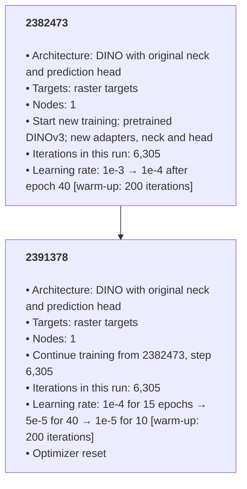
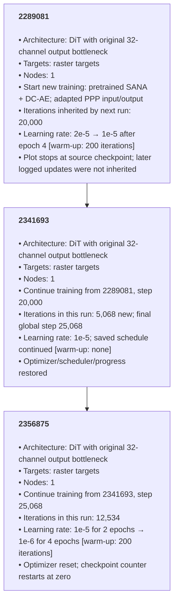

# Initial and final DINO / DiT training lineages

Production training histories, organized into the initial raster-target models and the final model lineages. Each section includes the checkpoint lineage, architecture/target changes, and total-loss/learning-rate plots. RadarGen is the unchanged pretrained comparison baseline. Diagnostic, overfit and LR-sweep jobs are omitted.

## Initial DINO runs

These are the original **discrete/raster-target** DINO production runs, before the wider neck and joint prediction head. Both used **one node (four GPUs)**. They also appear below as ancestors of the final DINO lineage; repeated IDs refer to the same runs, not additional training.

Run `2382473` started from pretrained DINOv3, keeping the base backbone frozen while training modality-specific LoRA adapters, feature fusion, the **384-channel, 12-layer RoPE neck**, and the progressive PixelShuffle head. It predicted **three 512×512 fields**: intensity, RCS and Doppler. The raster target construction selected detections onto cells and discarded collisions. The learning rate was `1e-3`, reduced to `1e-4` after epoch 40, with a 200-iteration warm-up. It completed **6,305 iterations over 65 epochs**.

Run `2391378` continued from that final checkpoint with all model weights, the same architecture and targets, but a fresh optimizer and another 200-iteration warm-up. Its schedule was `1e-4` for 15 epochs, `5e-5` for 40, and `1e-5` for 10. It added **6,305 iterations over 65 epochs**, for **12,610 iterations across this initial lineage**. Later, `2658284` reused its DINO backbone/adapters while replacing the neck and head.

This is the repository's original DINO PPP implementation, sharing the frozen-DINO/LoRA and RoPE-neck approach in `MMSegTemplate`. The reference has a different head and four output fields, so it is not established as the exact master's-thesis model. See [the original model description](dino_ppp.md).

The two stages are **2382473 → 2391378**. The upper panel shows total training loss; the lower panel shows the recorded learning rate and labels each warm-up. The cumulative axis ends at **12,610 optimizer iterations**. [Download the plotted values](assets/model_training_lineage/initial_dino_lineage_total_loss.csv).

On the archived SS50 evaluation, `2391378` had slightly higher detection F1 (**0.2672**, versus **0.2661** for `2382473`). However, `2382473` had better location Chamfer (**1.7085** versus **1.7277**) and point-count absolute error (**216.66** versus **227.92**). Neither checkpoint was best on every metric. Sources: [2382473 evaluation](../evaluation/configs/PPP_validation_dinov3_2382473.yaml) and [2391378 evaluation](../evaluation/configs/PPP_validation_dinov3_2391378.yaml), with archived summaries under validation jobs `2403799` and `2403800`.

## Initial DiT runs

These are the original **discrete/raster-target** DiT production runs. All three used **one node (four GPUs)** and retained the **32-channel output bottleneck**. This is a separate training lineage from the continuous-target DiT run `2438928` shown below; `2438928` starts new training rather than continuing from `2356875`.

Run `2289081` began with pretrained SANA and DC-AE components adapted to predict PPP fields. Each modality's **1152-channel, 16×16 DiT features** passed through the final projection to **32 latent channels**, then the shared scalar DC-AE decoder reconstructed each **512×512 output field**. The conditioning encoder remained frozen; the DiT and output decoder trained. The learning rate was `2e-5`, reduced to `1e-5` after epoch 4, with a 200-iteration warm-up.

Run `2341693` restored the model, optimizer, scheduler and progress from **step 20,000 of `2289081`**. It added **5,068 iterations**, reaching global step **25,068** and completing six total epochs across the original/resumed training. There was **no new warm-up**, and the learning rate remained `1e-5`.

Run `2356875` continued from that final checkpoint with a fresh optimizer and reset step counter. It trained for another **six epochs / 12,534 iterations**, with a 200-iteration warm-up, `1e-5` for two epochs and `1e-6` for four. The architecture and raster targets stayed the same. The represented initial lineage therefore totals **37,602 optimizer iterations**.

The three stages are **2289081 → 2341693 → 2356875**. The plot includes `2289081` only through **step 20,000**, the checkpoint actually inherited by `2341693`; its log continues to at least step 23,980, but those later updates did not feed this lineage. The resumed segment starts at 20,001, avoiding overlapping updates. Stage widths reflect the selected checkpoints, ending at **37,602 cumulative iterations**. [Download the plotted values](assets/model_training_lineage/initial_dit_lineage_total_loss.csv).

The final checkpoint of `2356875` is the previous DiT selected by highest recorded SS50 detection F1: **0.2717**, with location Chamfer **1.6259**, IoU@1 m **0.3016**, and point-count absolute error **170.34**. Its final checkpoint is `epoch_6_step_12534.pth`; validation job **2369104** produced the archived result. See [the evaluation configuration](../evaluation/configs/PPP_validation_finetune_2356875.yaml) and [the SS50 comparison](SS50_selected_comparison.md).

The initial figures use the same conventions as the final figures: logarithmic total-loss and learning-rate panels, colored stages, dashed run boundaries, and explicit warm-up labels. The dark loss curve uses a 200-iteration exponential smoothing time constant, restarted at each run; learning rates are unsmoothed. Cumulative optimizer iterations are not elapsed time or equal data exposure, since batch sizes differ between runs. Values and source log paths are included in the downloadable CSVs.

## Final runs

The following map retains the ancestors that supplied weights to the final architectures. In particular, the initial DINO runs above are intentionally repeated. The original discrete-target DiT lineage ends at `2356875`; the final DiT lineage instead begins with fresh continuous-target training in `2438928`.

```mermaid
flowchart TD
    DP["<div style='width: 280px; text-align: left;'><b>2382473</b><br/><br/>• Architecture: DINO with original neck and prediction head<br/>• Targets: raster targets<br/>• Nodes: 1<br/>• Start new training: pretrained DINOv3; new adapters, neck and head<br/>• Iterations in this run: 6,305<br/>• Learning rate: 1e-3 → 1e-4 after epoch 40 [warm-up: 200 iterations]</div>"]
    D0["<div style='width: 280px; text-align: left;'><b>2391378</b><br/><br/>• Architecture: DINO with original neck and prediction head<br/>• Targets: raster targets<br/>• Nodes: 1<br/>• Continue training from 2382473, step 6,305<br/>• Iterations in this run: 6,305<br/>• Learning rate: 1e-4 for 15 epochs → 5e-5 for 40 → 1e-5 for 10 [warm-up: 200 iterations]<br/>• Optimizer reset</div>"]
    D1["<div style='width: 280px; text-align: left;'><b>2658284</b><br/><br/>• Architecture: DINO with wider neck and joint prediction head<br/>• Targets: continuous targets<br/>• Nodes: 1<br/>• Start new architecture using DINO backbone/adapters from 2391378, step 6,305<br/>• Iterations in this run: 10,000<br/>• Learning rate: Constant 1e-4 [warm-up: 100 iterations]<br/>• Neck/head start new; optimizer reset</div>"]
    D2["<div style='width: 280px; text-align: left;'><b>2684031</b><br/><br/>• Architecture: DINO with wider neck and joint prediction head<br/>• Targets: continuous targets<br/>• Nodes: 4<br/>• Continue training from 2658284, step 10,000<br/>• Iterations in this run: 9,971<br/>• Learning rate: Constant 1e-4 [warm-up: 100 iterations]<br/>• Optimizer reset</div>"]
    D3["<div style='width: 280px; text-align: left;'><b>2719598</b><br/><br/>• Architecture: DINO with wider neck and joint prediction head<br/>• Targets: continuous targets; RCS identity/L2<br/>• Nodes: 4<br/>• Continue training from 2684031, step 9,971<br/>• Iterations in this run: 9,979<br/>• Learning rate: Constant 1e-5 [warm-up: none]<br/>• Optimizer reset</div>"]
    D4["<div style='width: 280px; text-align: left;'><b>2737656</b><br/><br/>• Architecture: DINO with wider neck and joint prediction head<br/>• Targets: continuous targets; cubic/L1<br/>• Nodes: 1<br/>• Continue training from 2684031, step 9,971<br/>• Iterations in this run: 4,978<br/>• Learning rate: Constant 1e-5 [warm-up: 100 iterations]<br/>• Optimizer reset</div>"]
    D5["<div style='width: 280px; text-align: left;'><b>2744861</b><br/><br/>• Architecture: DINO with wider neck and joint prediction head<br/>• Targets: continuous targets; cubic/L1<br/>• Nodes: 4<br/>• Continue training from 2684031, step 9,971<br/>• Iterations in this run: 9,965<br/>• Learning rate: Cosine 1e-4 → 1e-5 over 45 epochs, then constant [warm-up: 100 iterations]<br/>• Optimizer reset</div>"]
    D6["<div style='width: 280px; text-align: left;'><b>2773475</b><br/><br/>• Architecture: DINO with wider neck and joint prediction head<br/>• Targets: continuous targets; cubic/L1<br/>• Nodes: 4<br/>• Continue training from 2684031, step 9,971<br/>• Iterations in this run: 9,943 new; final global step 19,914<br/>• Learning rate: New cosine 1e-4 → 1e-5 over 45 additional epochs, then constant [warm-up: none]<br/>• Optimizer/progress restored; scheduler replaced</div>"]
    TP["<div style='width: 280px; text-align: left;'><b>2438928</b><br/><br/>• Architecture: DiT with original 32-channel output bottleneck<br/>• Targets: continuous targets<br/>• Nodes: 1<br/>• Start new training: pretrained SANA + DC-AE; adapted PPP input/output<br/>• Iterations in this run: 12,534<br/>• Learning rate: Cosine 2e-5 → 1e-6 [warm-up: 200 iterations]</div>"]
    T0["<div style='width: 280px; text-align: left;'><b>2516862</b><br/><br/>• Architecture: DiT with original 32-channel output bottleneck<br/>• Targets: continuous targets<br/>• Nodes: 1<br/>• Continue training from 2438928, step 12,534<br/>• Iterations in this run: 12,534<br/>• Learning rate: 1e-5 for 3 epochs → 1e-6 for 3 epochs [warm-up: 200 iterations]<br/>• Optimizer reset</div>"]
    T1["<div style='width: 280px; text-align: left;'><b>2658827</b><br/><br/>• Architecture: DiT with joint prediction head; 32-channel output bottleneck removed<br/>• Targets: continuous targets<br/>• Nodes: 1<br/>• Start new architecture using DiT backbone from 2516862, step 12,534<br/>• Iterations in this run: 18,730<br/>• Learning rate: Constant 1e-5 [warm-up: none]<br/>• New prediction head; optimizer reset; frozen DC-AE conditioning retained</div>"]
    T2["<div style='width: 280px; text-align: left;'><b>2684032</b><br/><br/>• Architecture: DiT with joint prediction head; 32-channel output bottleneck removed<br/>• Targets: continuous targets<br/>• Nodes: 4<br/>• Continue training from 2658827, step 18,730<br/>• Iterations in this run: 17,822<br/>• Learning rate: Constant 1e-5 [warm-up: 100 iterations]<br/>• Optimizer reset</div>"]
    T3["<div style='width: 280px; text-align: left;'><b>2719596</b><br/><br/>• Architecture: DiT with joint prediction head; 32-channel output bottleneck removed<br/>• Targets: continuous targets; RCS identity/L2<br/>• Nodes: 4<br/>• Continue training from 2684032, step 17,822<br/>• Iterations in this run: 18,059<br/>• Learning rate: Constant 1e-6 [warm-up: none]<br/>• Optimizer reset</div>"]
    T4["<div style='width: 280px; text-align: left;'><b>2737655</b><br/><br/>• Architecture: DiT with joint prediction head; 32-channel output bottleneck removed<br/>• Targets: continuous targets; cubic/L1<br/>• Nodes: 1<br/>• Continue training from 2684032, step 17,822<br/>• Iterations in this run: 9,007<br/>• Learning rate: Constant 1e-6 [warm-up: 100 iterations]<br/>• Optimizer reset</div>"]
    T5["<div style='width: 280px; text-align: left;'><b>2744862</b><br/><br/>• Architecture: DiT with joint prediction head; 32-channel output bottleneck removed<br/>• Targets: continuous targets; cubic/L1<br/>• Nodes: 4<br/>• Continue training from 2684032, step 17,822<br/>• Iterations in this run: 18,178<br/>• Learning rate: Constant 1e-5 [warm-up: 100 iterations]<br/>• Optimizer reset</div>"]
    T6["<div style='width: 280px; text-align: left;'><b>2773477</b><br/><br/>• Architecture: DiT with joint prediction head; 32-channel output bottleneck removed<br/>• Targets: continuous targets; cubic/L1<br/>• Nodes: 4<br/>• Continue training from 2684032, step 17,822<br/>• Iterations in this run: 18,152 new; final global step 35,974<br/>• Learning rate: Constant 1e-5; saved scheduler continued [warm-up: none]<br/>• Optimizer/scheduler/progress restored</div>"]

    DP --> D0 --> D1 --> D2
    D2 --> D3
    D2 --> D4
    D2 --> D5
    D2 --> D6

    TP --> T0 --> T1 --> T2
    T2 --> T3
    T2 --> T4
    T2 --> T5
    T2 --> T6
```

### DINO: final training lineage

We began with the DINOv3 predictor in runs `2382473` and `2391378`. “Original neck and prediction head” means the first DINO PPP architecture in this repository: a frozen pretrained DINOv3 backbone with trainable modality-specific LoRA adapters, a 384-channel transformer neck, and a progressive PixelShuffle head producing three 512×512 fields (intensity, RCS and Doppler). Features from four backbone layers were projected and fused before entering the neck. These runs used raster targets, which selected detections onto a grid and discarded collisions. Run `2391378` continued training from `2382473`, with a new optimizer.

This follows the frozen-DINO/LoRA and 384-channel RoPE-neck design found in the supplied `MMSegTemplate` reference. It is not the exact reference model: the reference predicts four fields with a patch-rearrange head, whereas this DINO PPP model predicts three fields with a progressive head. The repository does not establish whether that reference is the exact model from the master's thesis, so “original” here describes the earlier repository architecture. See [the original DINO model](dino_ppp.md) and [the reference configuration](../MMSegTemplate/ppp_finals_TrafoEnc_CamDom_24k.py).

In `2658284`, we kept the learned DINO backbone and modality adapters from `2391378`, but changed the prediction path. Instead of combining four selected backbone layers and compressing the fused features to 384 channels, we concatenated the three modalities' final-layer features directly: 3 × 384 = **1152 channels**. The 12-layer RoPE neck was widened from **384 to 1152 channels**, with no fusion compression before it. The wider neck and new head started with fresh weights. We also unfroze the DINO backbone and RGB patch embedding so they could adapt to the BEV inputs.

The new head combines overlapping 3×3 convolutions, PixelShuffle upsampling, local refinement and alternating ordinary/shifted-window attention. It predicts **1024×1024 fields from 512×512 conditioning maps**, over the same physical area. Together with the wider neck, this replaces the old progressive decoder. Run `2658284` also uses **continuous detection targets**: every in-extent detection retains its coordinates and individual RCS/Doppler marks, including detections sharing an output cell. Thus this transition changes architecture, trainable components, output resolution and target formulation together; it does not isolate one of those changes. See [the final head design](final_ppp_head.md).

Run `2684031` continued from step 10,000 of `2658284` on four nodes at constant learning rate `1e-4`, with a fresh optimizer. Its final step 9,971 became the common starting checkpoint for the later experiments. We tried an RCS identity-link/L2 loss (`2719598`), a lower-rate cubic/L1 continuation (`2737656`), and a cosine schedule with a fresh optimizer (`2744861`). These are parallel branches from `2684031`, not successive stages.

The final continuation shown here is **`2773475`**. It starts again from `2684031`, step 9,971, restores its optimizer and training progress, and introduces a new cosine schedule from `1e-4` to `1e-5`, without another warmup. It adds **9,943 iterations**, reaching global step **19,914**. “Final” identifies the latest continuation in this lineage; it does not imply the best validation result.

The plot includes **2382473 → 2391378 → 2658284 → 2684031 → 2773475**, showing total loss above and the recorded learning rate below. The first three stages used **one node** each; the last two used **four nodes** each. The x-axis adds optimizer iterations across stages, ending at **42,524**. For `2658284`, it stops at the transferred step-10,000 checkpoint; later logged updates are excluded because the next run did not inherit them. The change at `2658284` includes a new neck/head, unfrozen backbone, continuous targets and higher output resolution, so the losses before and after this boundary are not a controlled comparison. [Download the plotted values](assets/model_training_lineage/dino_lineage_total_loss.csv).

### DiT: final training lineage

Runs `2438928` and `2516862` used the original DiT PPP output path, retaining the autoencoder's **32-channel latent bottleneck**. Each modality stream supplied 1152-channel transformer features on a 16×16 grid; the final DiT layer reduced these to 32 channels before the DC-AE decoder reconstructed the output field. Run `2438928` began from pretrained SANA and DC-AE assets; `2516862` continued from its step 12,534 with a fresh optimizer. Both runs already used **continuous detection targets**.

In `2658827`, we reused the DiT backbone from `2516862` but removed the final projection and radar-output DC-AE decoder. The three 1152-channel streams now concatenate into **3456 channels at 16×16**, which feed a newly initialized joint head predicting intensity, RCS and Doppler together. This removes the mandatory 1152-to-32 projection before decoding. The head uses the same convolution/PixelShuffle/shifted-attention design as DINO, but the DiT model loads **no DINO backbone or DINO weights**. Its frozen DC-AE conditioning encoder remains in place, and its output stays **512×512**. The target formulation remains continuous across this architecture change.

Run `2684032` continued from step 18,730 of `2658827` on four nodes at constant learning rate `1e-5`, with a fresh optimizer. Its final step 17,822 became the common starting point for the subsequent branches: RCS identity/L2 (`2719596`), lower-rate cubic/L1 (`2737655`), and another four-node cubic/L1 continuation with a fresh optimizer (`2744862`). As with DINO, these experiments all restart from the same baseline checkpoint.

The final continuation shown here is **`2773477`**. It restores the model, optimizer, scheduler and training progress from `2684032`, step 17,822. It keeps the constant learning rate `1e-5`, with no new warmup, and adds **18,152 iterations**, reaching global step **35,974**.

The plot includes **2438928 → 2516862 → 2658827 → 2684032 → 2773477**, showing total loss above and the recorded learning rate below. The first three stages used **one node** each; the last two used **four nodes** each. The cumulative axis ends at **79,772 optimizer iterations**. The architecture change at `2658827` starts a new prediction head, which explains the loss restart at that boundary. [Download the plotted values](assets/model_training_lineage/dit_lineage_total_loss.csv).

Both figures show total loss in the upper panel and recorded learning rate in the lower panel, with a shared cumulative-iteration axis. Both vertical axes are logarithmic. Each stage is labeled with its warm-up duration (200 or 100 iterations) or “No warm-up”; darker shading in the learning-rate panel marks the warm-up interval. Learning rates are plotted directly from the logs without smoothing; an initial zero rate is omitted on the log axis. Colored backgrounds and dashed lines mark run boundaries; labels above each stage give its run ID, node count and iteration count. Faint lines show logged batch losses; dark lines show exponential smoothing with a 200-iteration time constant, restarted at each run. No line is drawn across a run boundary. The cumulative x-axis counts each new optimizer update once, including for the restored-counter runs `2773475` and `2773477`; it is not the checkpoint step counter, elapsed time, or equal data exposure. Four-node updates process a different batch size from one-node updates, and batch settings also vary between earlier stages. Lines stop at the last logged loss, while stage widths extend to the selected checkpoint.

The figures were generated from archived Slurm logs by [the plotting script](../scripts/plot_final_lineage_losses.py). They show where training loss decreased within each stage. Loss levels across architecture/target changes, or between DINO and DiT, are not a direct model ranking: the output resolutions differ, and the PPP likelihood convention changes the raw loss with grid resolution. Held-out point-cloud metrics assess whether lower training loss improved generalization.

Iterations mean optimizer updates saved in the final checkpoint of that run, including warmup, without adding the source run's updates. Most continuations load all model weights but reset the optimizer, scheduler and step counter; their counts therefore start at zero. Runs `2773475` and `2773477` restore training state: their new iteration counts are the final global step minus the source step. Architecture changes (`2658284`, `2658827`) transfer only the stated backbone components and train new prediction components.

The DINO models from **`2658284` onward**, including every branch from `2684031`, use **continuous detection targets**: all in-extent radar detections retain their continuous coordinates and individual RCS/Doppler marks, including multiple detections falling in the same output cell. This target formulation is separate from the cubic/L1 versus identity/L2 mark-loss choice. See [continuous PPP targets](continuous_ppp_targets.md).

The earlier fine-tunes were **`2382473 → 2391378` (DINO)** and **`2438928 → 2516862` (DiT)**. The later `2658284` and `2658827` models then transferred selected components from these fine-tuned ancestors while creating new prediction components; those transitions were architecture changes, not full-model resumes.

**Every branch from `2684031` starts at its final step 9,971; every branch from `2684032` starts at final step 17,822.** In particular, the cubic/L1 runs do not inherit the identity/L2 experiments' weights.

| Stage | Nodes | DINO run | DINO LR schedule | DiT run | DiT LR schedule | New warmup | Initialization / state |
| --- | --- | --- | --- | --- | --- | --- | --- |
| Earlier initial | 1 | 2382473 | Step `1e-3 → 1e-4` after epoch 40 | 2438928 | Cosine `2e-5 → 1e-6` | 200 updates each | Earlier model generation |
| Earlier fine-tune | 1 | 2391378 | `1e-4` for 15 epochs, `5e-5` for 40, `1e-5` for 10 | 2516862 | `1e-5` for 3 epochs, then `1e-6` for 3 | 200 updates each | Parent weights; fresh optimizer/scheduler/progress |
| New architecture | 1 | 2658284 | Constant `1e-4` | 2658827 | Constant `1e-5` | DINO 100; DiT 0 | Partial transfer from older ancestors; fresh optimizer |
| Four-node baseline | 4 | **2684031** | Constant `1e-4` | **2684032** | Constant `1e-5` | 100 updates each | Parent weights only; fresh optimizer/scheduler/progress |
| RCS identity + L2 experiment | 4 | 2719598 | Constant `1e-5` | 2719596 | Constant `1e-6` | 0 | Four-node baseline weights; fresh optimizer/scheduler/progress |
| Cubic + L1 test, 6h | 1 | 2737656 | Constant `1e-5` | 2737655 | Constant `1e-6` | 100 updates each | Four-node baseline weights; fresh optimizer/scheduler/progress |
| Cubic + L1, 12h | 4 | 2744861 | Cosine `1e-4 → 1e-5` | 2744862 | Constant `1e-5` | 100 updates each | Four-node baseline weights; fresh optimizer/scheduler/progress |
| New continuation, 12h | 4 | **2773475** | Cosine `1e-4 → 1e-5` | **2773477** | Constant `1e-5` | **None** | **Four-node baseline weights + optimizer + progress/RNG**; DINO gets a new cosine, DiT retains scheduler |

Common settings for the recent architecture and continuation rows: continuous radar targets; cubic mark link + L1 for the normal runs. Only the RCS experiment changes RCS to identity + L2; Doppler stays cubic + signed L1. DINO uses **AdamW**, batch **24/GPU**; DiT uses **CAMEWrapper**, batch **19/GPU**. Each node has four GPUs, so the four-node runs use 16 workers. Warmup lengths above count optimizer updates. Cosine decays over 45 additional epochs and then holds at `1e-5`.

Current checkpoint reference: `2684031`, step 9,971, is the strongest DINO checkpoint in the SS50 sweep by F1 and by metric-win count against RadarGen. Within `2744861`, step 3,000 has the highest F1. The optimizer-restored runs have completed: `2773475` reached global step 19,914 and `2773477` reached global step 35,974; their results are recorded in the corresponding SS50 comparison documents.

Sources: historical checkpoint training contracts (LR schedules) and Slurm accounting (earlier node counts); each recent run's `submitted_config.yaml` under `/e/scratch/nxtaim-1/huber7/work_dirs_RadarGen/train/`, checkpoint source arguments in `jsc_jupiter/PPP_*.sbatch`, and the new [continuation setup](optimizer_state_continuation.md). Older ancestor transfers are the launch scripts' configured defaults. The identity/L2 experiment is labeled from its submitted experiment description; `mark_link: cubic` remains in that configuration for the unchanged Doppler link.

Historical note: `2382473` actually used `epoch_step`; its current repository config now describes a cosine approximation. The map records the executed schedule from the checkpoint.

Initialization caveat: `2438928` logged loading `Sana_600M_512px_MultiLing.pth`; the current `PPP_train.yaml` disables SANA weight loading and therefore does not describe that historical initialization. The DINO root uses the local `vit_small_patch16_dinov3.lvd1689m/model.safetensors` backbone. Partial-transfer scope is defined by `load_dino_features` and `load_ppp_backbone`; source checkpoints for older transfers follow the launcher defaults noted above.

## Key model comparison: initial versus final, against RadarGen

**Selection:** highest available whole-area detection F1 on the fixed SS50 set within each initial/final model family. Initial means the raster-target production lineages above; final means the revised architectures and their evaluated continuations. Initial DINO selects `2391378` over `2382473` by F1, although the latter has better localization/count error. The latest available final selections are DiT `2773477`, step **35,974**, and DINO `2773475`, step **15,000**. These supersede the older selection elsewhere in the historical notes. Unfinished checkpoint sweeps can still change the selection; no missing evaluation is treated as a loss.

All five reports contain the same **50 scene/frame pairs in the same order and use the same sampling seeds** (verified). Values are mean ± population standard deviation, or a scalar where that is what the evaluator reports. Underlining marks each model value that improves on RadarGen using the unrounded mean/scalar; **bold** marks RadarGen where none of the four models beats it (ties count as unbeaten); ↓ lower is better, ↑ higher is better, and — means unavailable. Checkpoints were selected on SS50, so this is a selection-set comparison rather than independent test evidence.

¹ Archived initial-model mark errors use target-cell evaluation, while final models use per-detection evaluation; these values are retained as recorded and are not highlighted because their evaluation semantics differ. Training budgets, batch sizes and output resolutions differ.

Parameter counts include all learned prediction-network weights, including frozen DINO weights: DiT + output decoder/head for DiT/RadarGen, and backbone + adapters + neck/head for DINO. Frozen DC-AE conditioning encoders, text encoders, shared BEV preprocessing networks and non-parameter buffers are excluded. Counts come from checkpoint tensor shapes; M = one million. RadarGen includes its RGB output decoder, while initial DiT uses the scalar-adapted decoder. Underlining in the size row means fewer parameters than RadarGen.

Compute is cumulative training cost through the selected checkpoint, including the ancestor runs whose weights it inherited (also when only a backbone was transferred). Values are **allocated GH200 GPU-hours / summed elapsed job hours**: elapsed hours × allocated GPUs, summed over stages; one node has four GPUs. Slurm accounting supplies full-job durations, including startup and diagnostics. Partial stages are cut at the timestamp of the selected update: `2289081` at 20,000, `2658284` at 10,000, and `2773475` at 15,000; their values are approximate and omit subsequent checkpoint-save overhead. External SANA/DINO/DC-AE pretraining, BEV preprocessing, validation, and discarded experimental branches are excluded. RadarGen training compute is unavailable, so the compute row has no relative highlighting.

Sources: [Initial DiT 2356875](/e/scratch/nxtaim-1/huber7/work_dirs_RadarGen/validation/2369104_PPP_validation_finetune_2356875/summary.json), [Initial DINO 2391378](/e/scratch/nxtaim-1/huber7/work_dirs_RadarGen/validation/2403800_PPP_validation_dinov3_2391378/summary.json), [Final DiT 2773477](/e/scratch/nxtaim-1/huber7/work_dirs_RadarGen/validation/2788376_PPP_validation_ss50_2773477/summary.json), [Final DINO 2773475](/e/scratch/nxtaim-1/huber7/work_dirs_RadarGen/validation/SS50_dino_2773475_checkpoint_sweep/step_015000/summary.json), [RadarGen pretrained](/e/scratch/nxtaim-1/huber7/work_dirs_RadarGen/validation/2404702_RadarGen_validation/summary.json).

| Scope | Metric | **Initial DiT** `2356875` Raster targets; 32-channel bottleneck | **Initial DINO** `2391378` Raster targets; frozen DINO; 384-wide neck | **Final DiT** `2773477` Continuous targets; joint head; output bottleneck removed | **Final DINO** `2773475` Continuous targets; unfrozen DINO; 1152-wide neck; 1024 output | **RadarGen** `pretrained` Diffusion baseline; DC-AE; IRL1 point recovery |
| --- | --- | --- | --- | --- | --- | --- |
| Entire area | Location Chamfer ↓ | <u>1.626 ± 0.345</u> | 1.728 ± 0.382 | 1.704 ± 0.460 | <u>1.526 ± 0.321</u> | 1.685 ± 0.381 |
| Entire area | Full Chamfer ↓ | 0.041 ± 0.008 | 0.043 ± 0.010 | 0.042 ± 0.009 | <u>0.037 ± 0.007</u> | 0.040 ± 0.008 |
| Entire area | IoU@1 m ↑ | 0.302 ± 0.102 | 0.281 ± 0.095 | 0.298 ± 0.113 | <u>0.336 ± 0.107</u> | 0.312 ± 0.105 |
| Entire area | Detection recall ↑ | 0.270 ± 0.103 | 0.260 ± 0.094 | 0.247 ± 0.116 | <u>0.381 ± 0.128</u> | 0.302 ± 0.122 |
| Entire area | Detection precision ↑ | <u>0.278 ± 0.111</u> | <u>0.284 ± 0.099</u> | <u>0.278 ± 0.127</u> | <u>0.263 ± 0.090</u> | 0.197 ± 0.099 |
| Entire area | Detection F1 ↑ | <u>0.272 ± 0.106</u> | <u>0.267 ± 0.093</u> | <u>0.258 ± 0.121</u> | <u>0.309 ± 0.104</u> | 0.234 ± 0.107 |
| Entire area | MMD location ↓ | <u>0.040 ± 0.038</u> | <u>0.048 ± 0.043</u> | 0.065 ± 0.063 | <u>0.040 ± 0.035</u> | 0.064 ± 0.058 |
| Entire area | MMD RCS ↓ | 0.267 ± 0.177 | 0.387 ± 0.293 | 0.248 ± 0.217 | 0.263 ± 0.163 | **0.097 ± 0.162** |
| Entire area | MMD Doppler ↓ | <u>0.256 ± 0.567</u> | <u>0.190 ± 0.403</u> | <u>0.269 ± 0.580</u> | <u>0.134 ± 0.312</u> | 0.357 ± 0.958 |
| Foreground | Location Chamfer ↓ | 1.094 ± 0.634 | 1.119 ± 0.671 | 1.144 ± 0.774 | <u>0.925 ± 0.549</u> | 1.032 ± 0.713 |
| Foreground | Full Chamfer ↓ | <u>0.064 ± 0.041</u> | <u>0.062 ± 0.041</u> | <u>0.063 ± 0.047</u> | <u>0.060 ± 0.046</u> | 0.071 ± 0.051 |
| Foreground | Density similarity ↑ | 0.394 ± 0.336 | 0.377 ± 0.345 | 0.354 ± 0.359 | 0.445 ± 0.347 | **0.450 ± 0.347** |
| Foreground | Hit rate ↑ | 0.770 | 0.740 | 0.669 | <u>0.814</u> | 0.781 |
| Counts | GT points | 1095.540 ± 320.639 | 1095.540 ± 320.639 | 1095.540 ± 320.639 | 1095.540 ± 320.639 | 1095.540 ± 320.639 |
| Counts | Generated points | 1092.400 ± 323.830 | 1007.420 ± 337.410 | 980.380 ± 305.957 | 1576.300 ± 420.567 | 1717.860 ± 462.256 |
| Counts | Point-count absolute error ↓ | <u>170.340 ± 190.410</u> | <u>227.920 ± 178.401</u> | <u>210.760 ± 182.916</u> | <u>485.680 ± 260.657</u> | 623.040 ± 441.057 |
| Counts | PPP expected total | 1092.612 ± 322.232 | 1015.006 ± 338.592 | 976.778 ± 300.772 | 1571.546 ± 419.999 | — |
| Counts | PPP total-count absolute error ↓ | 171.862 ± 192.052 | 221.245 ± 182.525 | 211.093 ± 179.453 | 481.026 ± 260.719 | — |
| Marks¹ | RCS MAE ↓ | 4.533 ± 1.661 | 4.670 ± 1.693 | 4.806 ± 1.826 | 4.846 ± 1.841 | 6.093 ± 1.993 |
| Marks¹ | Doppler MAE ↓ | 1.985 ± 1.197 | 1.726 ± 1.110 | 2.027 ± 1.386 | 1.815 ± 1.291 | 3.142 ± 1.766 |
| Foreground counts | PPP expected count per box | 4.456 ± 6.365 | 3.859 ± 5.810 | 4.821 ± 8.810 | 6.938 ± 10.344 | — |
| Foreground counts | PPP count absolute error per box ↓ | 5.319 ± 7.368 | 5.648 ± 8.235 | 6.091 ± 8.703 | 5.015 ± 7.313 | — |
| Foreground counts | PPP hit probability ↑ | 0.777 ± 0.259 | 0.748 ± 0.283 | 0.717 ± 0.295 | 0.807 ± 0.279 | — |
| Foreground (car) | MMD location ↓ | 0.150 | 0.250 | 0.159 | <u>0.056</u> | 0.072 |
| Foreground (car) | MMD RCS ↓ | 0.047 | 0.080 | 0.027 | 0.273 | **0.012** |
| Foreground (car) | MMD Doppler ↓ | 0.069 | 0.089 | 0.082 | 0.068 | **0.046** |
| Foreground (truck) | MMD location ↓ | 0.113 | <u>0.077</u> | 0.196 | <u>0.072</u> | 0.101 |
| Foreground (truck) | MMD RCS ↓ | 0.211 | 0.282 | 0.097 | 0.157 | **0.020** |
| Foreground (truck) | MMD Doppler ↓ | 0.178 | 0.208 | <u>0.100</u> | 0.200 | 0.108 |
| Foreground (trailer) | MMD location ↓ | <u>0.024</u> | <u>0.025</u> | 0.085 | 0.042 | 0.032 |
| Foreground (trailer) | MMD RCS ↓ | 1.100 | 0.692 | 0.327 | 0.515 | **0.049** |
| Foreground (trailer) | MMD Doppler ↓ | 0.568 | 1.244 | 1.104 | 0.384 | **0.343** |
| Runtime | Inference seconds/frame ↓ | — | <u>0.059 ± 0.001</u> | <u>0.178 ± 0.004</u> | <u>0.257 ± 0.001</u> | 1.185 ± 0.028 |
| Model size | Prediction-network parameters (M) ↓ | 751.110 | <u>55.019</u> | <u>657.933</u> | <u>239.863</u> | 751.085 |
| Training compute | Cumulative GPU-hours / elapsed hours | ≈86.3 / 21.6 | ≈81.5 / 20.4 | ≈513.0 / 56.8 | ≈414.5 / 50.0 | — |
