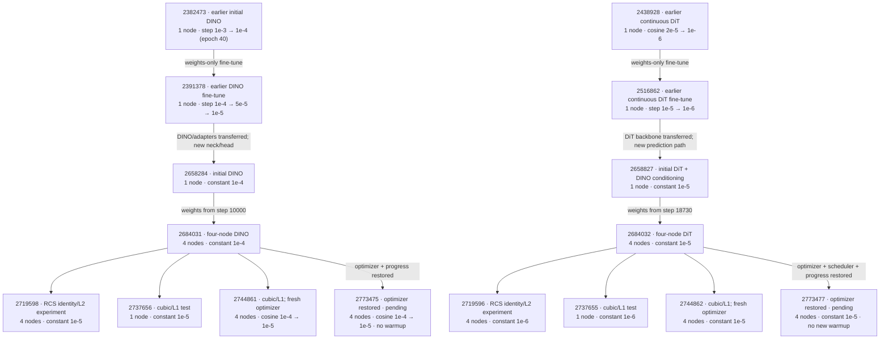

# DINO / DiT training lineage

Essential map of the recent production models and continuation experiments. RadarGen is the unchanged pretrained comparison baseline. Older architecture/overfit/LR-sweep experiments are omitted; the earlier initial models and fine-tuned ancestors are included below.

The earlier fine-tunes were **`2382473 → 2391378` (DINO)** and **`2438928 → 2516862` (DiT)**. The later `2658284` and `2658827` models then transferred selected components from these fine-tuned ancestors while creating new prediction components; those transitions were architecture changes, not full-model resumes.

**Every branch from `2684031` starts at its final step 9,971; every branch from `2684032` starts at final step 17,822.** In particular, the cubic/L1 runs do not inherit the identity/L2 experiments' weights.

| Stage | Nodes | DINO run | DINO LR schedule | DiT run | DiT LR schedule | New warmup | Initialization / state |
| --- | --- | --- | --- | --- | --- | --- | --- |
| Earlier initial | 1 | 2382473 | Step `1e-3 → 1e-4` after epoch 40 | 2438928 | Cosine `2e-5 → 1e-6` | 200 updates each | Earlier model generation |
| Earlier fine-tune | 1 | 2391378 | `1e-4` for 15 epochs, `5e-5` for 40, `1e-5` for 10 | 2516862 | `1e-5` for 3 epochs, then `1e-6` for 3 | 200 updates each | Parent weights; fresh optimizer/scheduler/progress |
| New architecture | 1 | 2658284 | Constant `1e-4` | 2658827 | Constant `1e-5` | DINO 100; DiT 0 | Partial transfer from older ancestors; fresh optimizer |
| Four-node baseline | 4 | **2684031** | Constant `1e-4` | **2684032** | Constant `1e-5` | 100 updates each | Parent weights only; fresh optimizer/scheduler/progress |
| RCS identity + L2 experiment | 4 | 2719598 | Constant `1e-5` | 2719596 | Constant `1e-6` | 0 | Four-node baseline weights; fresh optimizer/scheduler/progress |
| Cubic + L1 test, 6h | 1 | 2737656 | Constant `1e-5` | 2737655 | Constant `1e-6` | 100 updates each | Four-node baseline weights; fresh optimizer/scheduler/progress |
| Cubic + L1, 12h | 4 | 2744861 | Cosine `1e-4 → 1e-5` | 2744862 | Constant `1e-5` | 100 updates each | Four-node baseline weights; fresh optimizer/scheduler/progress |
| New continuation, 12h | 4 | **2773475** | Cosine `1e-4 → 1e-5` | **2773477** | Constant `1e-5` | **None** | **Four-node baseline weights + optimizer + progress/RNG**; DINO gets a new cosine, DiT retains scheduler |

Common settings for the recent architecture and continuation rows: continuous radar targets; cubic mark link + L1 for the normal runs. Only the RCS experiment changes RCS to identity + L2; Doppler stays cubic + signed L1. DINO uses **AdamW**, batch **24/GPU**; DiT uses **CAMEWrapper**, batch **19/GPU**. Each node has four GPUs, so the four-node runs use 16 workers. Warmup lengths above count optimizer updates. Cosine decays over 45 additional epochs and then holds at `1e-5`.

Current checkpoint reference: `2684031`, step 9,971, is the strongest DINO checkpoint in the SS50 sweep by F1 and by metric-win count against RadarGen. Within `2744861`, step 3,000 has the highest F1. The new continuations were pending when this map was created; they have no results yet.

Sources: historical checkpoint training contracts (LR schedules) and Slurm accounting (earlier node counts); each recent run's `submitted_config.yaml` under `/e/scratch/nxtaim-1/huber7/work_dirs_RadarGen/train/`, checkpoint source arguments in `jsc_jupiter/PPP_*.sbatch`, and the new [continuation setup](optimizer_state_continuation.md). Older ancestor transfers are the launch scripts' configured defaults. The identity/L2 experiment is labeled from its submitted experiment description; `mark_link: cubic` remains in that configuration for the unchanged Doppler link.

Historical note: `2382473` actually used `epoch_step`; its current repository config now describes a cosine approximation. The map records the executed schedule from the checkpoint.
